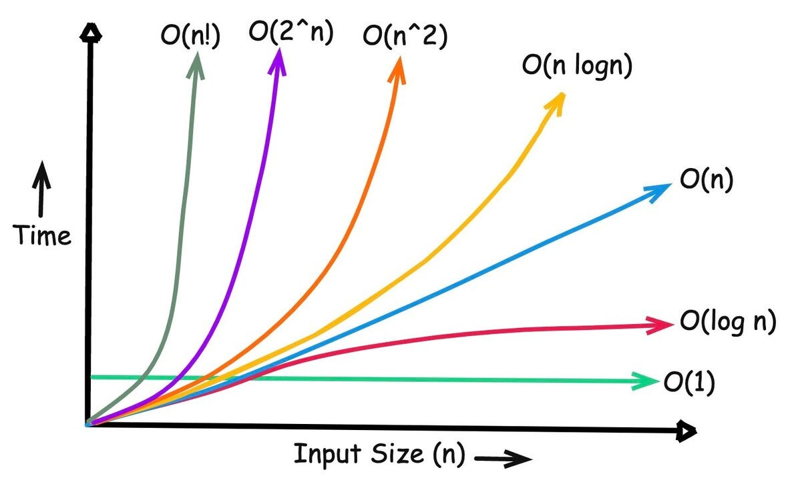

## I. Intro: The Big Picture View: What is DS & A?

Every software problem boils down to 2 aspects:

- **Data Structures** - *"The Containers"*
    - How you organize and store data in memory (e.g.: Arrays, Hash Maps, Trees)

- **Algorithms** - *"The Recipes"
    - The step-by-step instructions used to manipulate that data and solve a problem


```{mermaid}
flowchart LR
    RDI("Raw Data Input")
    DS["Data Structures<br>How Data is Stored"]
    AL["Algorithm<br>The Step-by-Step Logic"]
    OS("Optimal Solution")

    RDI --> DS --> AL --> OS
```

### Contents of the blog in 1 Pic:

```{mermaid}
flowchart LR
    %% Left Subgraph: Algorithm Patterns
    subgraph PAT ["Algorithm Patterns"]
        direction TB
        Start{"What kind of<br>problem is it?"}
        Start -->|"Sorted Array<br>/ Pairs"| TP["Two Pointers<br>Pattern"]
        Start -->|"Contiguous<br>Subarray"| SW["Sliding Window<br>Pattern"]
        Start -->|"Fast Counting<br>/ Duplicates"| HM["Hash Map<br>Frequency Pattern"]
        Start -->|"Sorted Data /<br>Search Space"| BS["Binary Search<br>Pattern"]
        Start -->|"Shortest Path /<br>Level-by-Level"| BFS["Breadth-First<br>Search (BFS)"]
        Start -->|"All Combinations<br>/ Paths"| DFS["Depth-First<br>Search<br>/ Backtracking"]
    end

    %% Right Subgraph: Core Data Structures (Unlinked)
    subgraph DS ["Core Data<br>Structures"]
        direction TB
        A["1. Arrays & Strings<br><br>Contiguous memory,<br>index-based"]
        B["2. Hash Maps & Sets<br><br>Key-value pairs,<br>O(1) instant<br>lookups"]
        C["3. Linked Lists<br><br>Nodes connected<br>via pointers"]
        D["4. Stacks & Queues<br><br>LIFO vs.<br>FIFO ordering"]
        E["5. Trees & Graphs<br><br>Hierarchical &<br>networked data"]
    end

    %% Connections: Patterns -> Data Structures
    TP -->|"uses"| A 
    TP --> |"uses"| C
    SW -->|"uses"| A 
    SW --> |"uses"| B
    HM -->|"uses"| B
    BS -->|"uses"| A
    BFS -->|"uses Queue<br>(FIFO)"| D
    BFS -->|"traverses"| E
    DFS -->|"uses Stack /<br>Recursion"| D
    DFS -->|"traverses"| E

    %% Styling Patterns
    style PAT fill:#f8fafc,stroke:#94a3b8,stroke-width:2px
    style Start fill:#1e293b,color:#ffffff,stroke:#0f172a
    style TP fill:#dbeafe,stroke:#2563eb,stroke-width:2px
    style SW fill:#e0e7ff,stroke:#4f46e5,stroke-width:2px
    style HM fill:#dcfce7,stroke:#16a34a,stroke-width:2px
    style BS fill:#fef9c3,stroke:#ca8a04,stroke-width:2px
    style BFS fill:#fae8ff,stroke:#a21caf,stroke-width:2px
    style DFS fill:#ffe4e6,stroke:#e11d48,stroke-width:2px

    %% Styling Data Structures
    style DS fill:#f8fafc,stroke:#94a3b8,stroke-width:2px
    style A fill:#f0fdf4,stroke:#16a34a,stroke-width:2px
    style B fill:#eff6ff,stroke:#2563eb,stroke-width:2px
    style C fill:#fefce8,stroke:#ca8a04,stroke-width:2px
    style D fill:#faf5ff,stroke:#9333ea,stroke-width:2px
    style E fill:#fff1f2,stroke:#e11d48,stroke-width:2px
```

--- 

## 2. Measuring Efficiency via Big-O Notation

**Big O Notation** measures how the runtime or memory of your algorithm grows as the input size ($N$) grows.

| Big O             | Name         | Intuition                                                | Example                                                         |
| ----------------- | ------------ | -------------------------------------------------------- | --------------------------------------------------------------- |
| **$O(1)$**        | Constant     | Instant lookup regardless of data size.                  | Accessing an array element by index (`arr[0]`).                 |
| **$O(\log N)$**   | Logarithmic  | Cuts the problem size in half every step.                | Binary Search in a sorted list.                                 |
| **$O(N)$**        | Linear       | Visits each element once.                                | Looping through an array to find the max value.                 |
| **$O(N \log N)$** | Linearithmic | Efficient sorting speed.                                 | Merge Sort, Quick Sort (`sorted()`).                            |
| **$O(N^2)$**      | Quadratic    | Nested loops (comparing every item to every other item). | Checking all pairs in a list (usually too slow for interviews). |



---

## 3. Data Structures

### 3.1. Arrays & Strings (Contiguous Memory)

An **Array** (a `list` in Python) stores elements side-by-side in adjacent memory slots, allowing instant $O(1)$ access by index. However, inserting or deleting in the middle requires shifting subsequent elements ($O(N)$). A **String** behaves identically, except it is immutable.

  
#### Visualizing Memory Layout & Shifting

```{mermaid}
flowchart LR
    subgraph Mem ["Contiguous Memory (Instant O(1) Lookup via Index)"]
        direction LR
        I0["Index 0<br><b>10</b>"] --- I1["Index 1<br><b>20</b>"] --- I2["Index 2<br><b>30</b>"] --- I3["Index 3<br><b>40</b>"]
    end

    Insert(["Insert <b>99</b><br>at Index 1"]) -.->|"Forces Shift →<br>O(N) Cost"| I1

    style Mem fill:#f0fdf4,stroke:#16a34a,stroke-width:2px
    style I0 fill:#ffffff,stroke:#16a34a
    style I1 fill:#dcfce7,stroke:#16a34a,stroke-width:2px
    style I2 fill:#ffffff,stroke:#16a34a
    style I3 fill:#ffffff,stroke:#16a34a
    style Insert fill:#fef9c3,stroke:#ca8a04,stroke-width:2px
```

### Concrete Example


```python
arr = [10, 20, 30, 40]

# 1. Instant Read by Index -> O(1)
print(arr[2])        # Output: 30

# 2. Append to the very end -> O(1) amortized
arr.append(50)       # [10, 20, 30, 40, 50]

# 3. Insert in the middle -> O(N) because 20, 30, 40, 50 must shift right
arr.insert(1, 99)    # [10, 99, 20, 30, 40, 50]
```

### 3.2. Hash Maps & Sets (Instant Key-Value Lookups)

A **Hash Map** (Python `dict`) passes a key through a **hash function** to compute an exact memory address. This gives $O(1)$ average time for lookups, insertions, and deletions—eliminating the need to scan through items one by one. A **Hash Set** (`set`) is simply a Hash Map that stores only keys (no values) to enforce uniqueness.

  

#### Visualizing the Hashing Pipeline

```{mermaid}
flowchart LR
    K1(["Key: 'apple'"]) --> HF["Hash Function<br>hash('apple') % size"]
    K2(["Key: 'banana'"]) --> HF

    subgraph Table ["Hash Table Buckets (O(1) Direct Jump)"]
        direction TB
        B0["Bucket 0: empty"]
        B1["Bucket 1: 'apple' → $1.20"]
        B2["Bucket 2: 'banana' → $0.50"]
    end

    HF -->|"Index 1"| B1
    HF -->|"Index 2"| B2

    style Table fill:#eff6ff,stroke:#2563eb,stroke-width:2px
    style HF fill:#dbeafe,stroke:#2563eb,stroke-width:2px
    style B1 fill:#ffffff,stroke:#2563eb
    style B2 fill:#ffffff,stroke:#2563eb
```

### Concrete Example


```python
# Hash Map (Dictionary): Key -> Value
prices = {"apple": 1.20, "banana": 0.50}

# 1. Instant Lookup & Update -> O(1)
prices["cherry"] = 2.50
print(prices.get("apple"))   # Output: 1.20

# 2. Hash Set: Instant Duplicate Check -> O(1)
seen = set([1, 2, 2, 3])     # {1, 2, 3}
print(2 in seen)             # Output: True (no loop required!)
```

### 3.3. Linked Lists (Pointer-Connected Nodes)

Unlike arrays, **Linked List** nodes are scattered randomly in memory. Each node holds two things: its **data** and a **`next` pointer** referencing the address of the following node. Inserting or deleting a node is $O(1)$ once you are at that position because you only re-wire pointers—no shifting needed.

  

#### Visualizing Node Wiring & Insertion

```{mermaid}
flowchart LR
    Head(["HEAD"]) --> N1["Node 1<br>Data: 10 | Next"]
    N1 -->|"points to"| N2["Node 2<br>Data: 20 | Next"]
    N2 -.->|"broken link"| N3["Node 3<br>Data: 30 | Next"]
    N3 --> Null(["NULL"])

    New["New Node<br>Data: 99 | Next"]
    N2 ==>|"1. re-wire"| New
    New ==>|"2. re-wire"| N3

    style Head fill:#1e293b,color:#ffffff
    style Null fill:#64748b,color:#ffffff
    style N1 fill:#fefce8,stroke:#ca8a04,stroke-width:2px
    style N2 fill:#fefce8,stroke:#ca8a04,stroke-width:2px
    style N3 fill:#fefce8,stroke:#ca8a04,stroke-width:2px
    style New fill:#dcfce7,stroke:#16a34a,stroke-width:2px
```

### Concrete Example


```python
class ListNode:
    def __init__(self, val=0, next=None):
        self.val = val
        self.next = next

# Build chain: 10 -> 20 -> 30
head = ListNode(10, ListNode(20, ListNode(30)))

# Insert 99 between 20 and 30 in O(1) time (no shifting!)
node_20 = head.next
new_node = ListNode(99, node_20.next)  # 99 points to 30
node_20.next = new_node                # 20 points to 99
# Chain is now: 10 -> 20 -> 99 -> 30
```

### 3.4. Stacks & Queues (Ordered Access Rules)

**Stacks** and **Queues** restrict _where_ you can add or remove items to enforce strict processing order in $O(1)$ time:

  

- **Stack (LIFO — Last In, First Out):** Like a vertical stack of plates. The last item pushed on top is the first one popped off.
    
      
    
- **Queue (FIFO — First In, First Out):** Like a checkout line. The first item added to the back is the first one served from the front.
    
      
    

#### Visualizing LIFO vs. FIFO Flow


```{mermaid}
flowchart LR
    subgraph StackBox ["STACK (LIFO: Last In, First Out)"]
        direction TB
        S_In(["Push / Pop<br>at TOP"]) <--> S3["3 (Top)"]
        S3 --- S2["2"]
        S2 --- S1["1 (Bottom)"]
    end

    subgraph QueueBox ["QUEUE (FIFO: First In, First Out)"]
        direction LR
        Q_In(["Enqueue<br>(Back)"]) --> Q3["3"] --- Q2["2"] --- Q1["1 (Front)"]
        Q1 --> Q_Out(["Dequeue<br>(Front)"])
    end

    style StackBox fill:#faf5ff,stroke:#9333ea,stroke-width:2px
    style QueueBox fill:#eff6ff,stroke:#2563eb,stroke-width:2px
    style S_In fill:#f3e8ff,stroke:#9333ea
    style Q_In fill:#dbeafe,stroke:#2563eb
    style Q_Out fill:#dbeafe,stroke:#2563eb
```

### Concrete Example


```python
from collections import deque

# 1. STACK (LIFO) using a standard Python list
stack = []
stack.append("Page 1")   # Push
stack.append("Page 2")   # Push
print(stack.pop())       # Pop -> "Page 2" (Last In, First Out)

# 2. QUEUE (FIFO) using deque for O(1) front removal
queue = deque()
queue.append("User A")   # Enqueue at back
queue.append("User B")   # Enqueue at back
print(queue.popleft())   # Dequeue from front -> "User A" (First In, First Out)
```

### 3.55. Trees & Graphs (Hierarchical vs. Networked Data)

- **Trees:** Hierarchical structures starting from a single **Root** node, branching down to **Child** nodes with **no cycles**. In a **Binary Search Tree (BST)**, left children are smaller and right children are larger, enabling $O(\log N)$ search.
    
      
    
- **Graphs:** Flexible networks of **Vertices (Nodes)** connected by **Edges**. Unlike trees, graphs have no single root, can contain **cycles** (loops), and edges can be one-way (directed) or two-way (undirected).
    

#### Visualizing Tree Hierarchy vs. Graph Network


```{mermaid}
flowchart LR
    subgraph TreeBox ["BINARY SEARCH TREE (Hierarchical, No Cycles)"]
        direction TB
        R(("8<br>(Root)")) --> L(("3<br>(Left < 8)"))
        R --> RT(("10<br>(Right > 8)"))
        L --> LL(("1"))
        L --> LR(("6"))
    end

    subgraph GraphBox ["GRAPH (Networked, Allows Cycles)"]
        direction TB
        A(("City A")) <-->|"Flight"| B(("City B"))
        B -->|"Train"| C(("City C"))
        C -->|"Bus (Cycle!)"| A
    end

    style TreeBox fill:#fff1f2,stroke:#e11d48,stroke-width:2px
    style GraphBox fill:#fefce8,stroke:#ca8a04,stroke-width:2px
    style R fill:#ffe4e6,stroke:#e11d48,stroke-width:2px
```

### Concrete Example


```python
# 1. TREE: Node with left and right children
class TreeNode:
    def __init__(self, val):
        self.val = val
        self.left = None
        self.right = None

root = TreeNode(8)
root.left = TreeNode(3)
root.right = TreeNode(10)

# 2. GRAPH: Adjacency List (Hash Map mapping each node to its neighbors)
graph = {
    "City A": ["City B"],
    "City B": ["City A", "City C"],
    "City C": ["City A"]   # Cycle back to City A
}
print(graph["City B"])     # Output: ['City A', 'City C']
```

---

## 4. DSA Patterns

```{mermaid}

flowchart TD
    Start{What kind of problem is it?}
    
    Start -->|Sorted Array / Pairs| TP[Two Pointers Pattern]
    Start -->|Contiguous Subarray / Substring| SW[Sliding Window Pattern]
    Start -->|Fast Counting / Duplicates| HM[Hash Map Frequency Pattern]
    Start -->|Sorted Data / Search Space| BS[Binary Search Pattern]
    Start -->|Shortest Path / Level-by-Level| BFS[Breadth-First Search BFS]
    Start -->|All Combinations / Maze / Paths| DFS[Depth-First Search / Backtracking]

    style Start fill:#1e293b,color:#ffffff,stroke:#0f172a
    style TP fill:#dbeafe,stroke:#2563eb
    style SW fill:#e0e7ff,stroke:#4f46e5
    style HM fill:#dcfce7,stroke:#16a34a
    style BS fill:#fef9c3,stroke:#ca8a04
    style BFS fill:#fae8ff,stroke:#a21caf
    style DFS fill:#ffe4e6,stroke:#e11d48
```


### 1. Pattern: Two Pointers

The **Two Pointers** pattern uses two indices to iterate through a data structure simultaneously. It is typically applied to **sorted arrays** or **linked lists** to search for pairs or perform in-place modifications in $O(N)$ time and $O(1)$ space.

#### Visualizing Two Pointers (Opposite Direction)

```{mermaid}
graph LR
    %% Array nodes
    1((1)) --- 2((2)) --- 3((4)) --- 4((7)) --- 5((11)) --- 6((15))

    %% Pointer styling
    classDef defaultNode fill:#ffffff,stroke:#cbd5e1,stroke-width:2px;
    classDef leftPointer fill:#dbeafe,stroke:#2563eb,stroke-width:3px,font-weight:bold,color:#1e40af;
    classDef rightPointer fill:#fce7f3,stroke:#db2777,stroke-width:3px,font-weight:bold,color:#9d174d;

    class 1 leftPointer;
    class 6 rightPointer;
    class 2,3,4,5 defaultNode;

    subgraph L ["Left Pointer (Index 0)"]
        1
    end

    subgraph R ["Right Pointer (Index 5)"]
        6
    end

    style L fill:#eff6ff,stroke:#3b82f6,stroke-width:1px,stroke-dasharray: 3 3
    style R fill:#fdf2f8,stroke:#ec4899,stroke-width:1px,stroke-dasharray: 3 3

```

#### Example Problem: Two Sum II (Sorted Array)

Given a 1-indexed array of integers `numbers` that is already sorted in non-decreasing order, find two numbers such that they add up to a specific `target`.

**Intuition & Mechanics**

* Initialize `left = 0` and `right = n - 1`.
* If `numbers[left] + numbers[right] == target`, we found the pair!
* If the sum is **too small**, increment `left` to increase the value.
* If the sum is **too large**, decrement `right` to decrease the value.

**Python Implementation**

```python
def twoSum(numbers: list[int], target: int) -> list[int]:
    left, right = 0, len(numbers) - 1
    
    while left < right:
        current_sum = numbers[left] + numbers[right]
        
        if current_sum == target:
            return [left + 1, right + 1]  # Returning 1-based indices
        elif current_sum < target:
            left += 1   # Need a larger sum -> move left pointer right
        else:
            right -= 1  # Need a smaller sum -> move right pointer left
            
    return []

# Complexity: Time: O(N) | Space: O(1)

```

---

### 2. Pattern: Sliding Window

The **Sliding Window** pattern performs required operations on a specific window size of a given array or linked list (e.g., finding the longest subarray containing all 1s). Windows can be of **fixed size** or **dynamic size**.

#### Visualizing Sliding Window (Fixed Size k=3)

```{mermaid}
graph LR
    %% Array elements: [2, 1, 5, 1, 3, 2]
    1((2)) --- 2((1)) --- 3((5)) --- 4((1)) --- 5((3)) --- 6((2))
    
    %% Window Box logic simulated via styling
    classDef defaultNode fill:#f8fafc,stroke:#94a3b8,stroke-width:2px;
    classDef windowNode fill:#bfdbfe,stroke:#3b82f6,stroke-width:3px,font-weight:bold,color:#1e40af;
    
    class 1,5,6 defaultNode;
    class 2,3,4 windowNode;
    
    %% Labels & Subgraph Box
    subgraph W1 ["Current Window (k=3)"]
        2
        3
        4
    end
    
    %% Style the Subgraph
    style W1 fill:#eff6ff,stroke:#3b82f6,stroke-width:2px,stroke-dasharray: 5 5

```

#### Example Problem: Maximum Sum Subarray of Size K (Fixed Window)

Given an array of positive integers and a positive number `k`, find the maximum sum of any contiguous subarray of size `k`.

**Intuition & Mechanics**

* Compute the sum of the first `k` elements to form the initial window.
* Slide the window forward one element at a time: **add** the new element entering the window, and **subtract** the old element leaving it.
* Keep track of the maximum sum seen so far. Avoid re-calculating the entire window sum from scratch!

**Python Implementation**

```python
def max_sub_array_of_size_k(k: int, arr: list[int]) -> int:
    if len(arr) < k:
        return 0
        
    window_sum = sum(arr[:k])  # Calculate initial window
    max_sum = window_sum
    
    # Slide the window across the array
    for i in range(len(arr) - k):
        # Subtract element exiting, add element entering
        window_sum = window_sum - arr[i] + arr[i + k]
        max_sum = max(max_sum, window_sum)
        
    return max_sum

# Example Usage:
# arr = [2, 1, 5, 1, 3, 2], k = 3 -> Output: 9 (subarray [5, 1, 3])
# Complexity: Time: O(N) | Space: O(1)

```

---

## Identifying the Patterns

| Use Two Pointers When:                                   | Use Sliding Window When:                                        |
| -------------------------------------------------------- | --------------------------------------------------------------- |
| Dealing with sorted arrays or linked lists.              | The problem input is a linear data structure (Array or String). |
| Searching for pairs, triplets, or quadruplets.           | Asked to find contiguous subarrays or substrings.               |
| Reversing arrays or working with palindromes.            | Asked for min/max/longest/shortest with a constraint.           |
| Comparing elements from opposite ends toward the middle. | Goal is to eliminate nested loops ($O(N^2) \rightarrow O(N)$).  |


---

## 3. Pattern: Hash Map Frequency Pattern

The **Hash Map Frequency Pattern** uses a hash table (a Python `dict` or `collections.Counter`) to store element counts, indices, or seen values. It trades $O(N)$ extra space to eliminate nested loops, turning slow $O(N^2)$ searches into fast $O(N)$ lookups.

### Visualizing Hash Map Lookup & Counting

```{mermaid}
graph LR
    subgraph Input ["Input Array: [4, 1, 2, 1, 2]"]
        A1((4)) --- A2((1)) --- A3((2)) --- A4((1)) --- A5((2))
    end

    subgraph Map ["Hash Map (Element -> Count)"]
        direction TB
        M1["4 : 1  <-- Unique!"]
        M2["1 : 2"]
        M3["2 : 2"]
    end

    A1 -.->|Count = 1| M1
    A2 & A4 -.->|Count = 2| M2
    A3 & A5 -.->|Count = 2| M3

    style Input fill:#f8fafc,stroke:#94a3b8,stroke-width:1px
    style Map fill:#f0fdf4,stroke:#16a34a,stroke-width:2px,stroke-dasharray: 4 4
    style M1 fill:#dcfce7,stroke:#16a34a,stroke-width:2px,font-weight:bold

```

### Example Problem: Valid Anagram

Given two strings `s` and `t`, return `True` if `t` is an anagram of `s` (uses the exact same characters with the exact same frequencies), and `False` otherwise.

**Intuition & Mechanics**

* If the lengths of `s` and `t` differ, they cannot be anagrams—return `False` immediately.
* Loop through string `s` and record the frequency of each character in a dictionary (`count[char] += 1`).
* Loop through string `t` and decrement the count for each character (`count[char] -= 1`).
* If a character is missing or its count drops below `0`, return `False`.

**Python Implementation**

```python
def isAnagram(s: str, t: str) -> bool:
    if len(s) != len(t):
        return False
        
    freq = {}
    
    # Count characters in s
    for char in s:
        freq[char] = freq.get(char, 0) + 1
        
    # Subtract characters using t
    for char in t:
        if char not in freq or freq[char] == 0:
            return False
        freq[char] -= 1
        
    return True

# Complexity: Time: O(N) | Space: O(1) (at most 26 lowercase letters)

```

---

## 4. Pattern: Binary Search Pattern

The **Binary Search Pattern** repeatedly divides a sorted search space in half. Instead of scanning every element one by one in $O(N)$ time, it inspects the middle element and eliminates half of the remaining candidates on every step, achieving $O(\log N)$ time complexity.

### Visualizing Binary Search (Target = 11)

```{mermaid}
graph LR
    %% Sorted Array
    1((1)) --- 2((3)) --- 3((5)) --- 4((7)) --- 5((11)) --- 6((15)) --- 7((19))

    classDef eliminated fill:#f1f5f9,stroke:#cbd5e1,color:#94a3b8;
    classDef midNode fill:#fef08a,stroke:#ca8a04,stroke-width:3px,font-weight:bold,color:#854d0e;
    classDef targetNode fill:#bbf7d0,stroke:#16a34a,stroke-width:3px,font-weight:bold,color:#14532d;

    class 1,2,3,4 eliminated;
    class 4 midNode;
    class 5 targetNode;

    subgraph Eliminated ["Discarded Left Half (7 < 11)"]
        1
        2
        3
        4
    end

    subgraph Active ["New Search Space"]
        5
        6
        7
    end

    style Eliminated fill:#f8fafc,stroke:#cbd5e1,stroke-dasharray: 4 4
    style Active fill:#fefce8,stroke:#ca8a04,stroke-width:2px

```

### Example Problem: Classic Binary Search

Given a sorted array of distinct integers `nums` and a `target` value, return the index if the target is found. If not, return `-1`.

**Intuition & Mechanics**

* Initialize `left = 0` and `right = len(nums) - 1`.
* While `left <= right`, calculate the midpoint `mid = (left + right) // 2`.
* If `nums[mid] == target`, return `mid`.
* If `nums[mid] < target`, the target must be in the right half—set `left = mid + 1`.
* If `nums[mid] > target`, the target must be in the left half—set `right = mid - 1`.

**Python Implementation**

```python
def search(nums: list[int], target: int) -> int:
    left, right = 0, len(nums) - 1
    
    while left <= right:
        mid = left + (right - left) // 2  # Prevents integer overflow
        
        if nums[mid] == target:
            return mid
        elif nums[mid] < target:
            left = mid + 1   # Discard left half
        else:
            right = mid - 1  # Discard right half
            
    return -1

# Complexity: Time: O(log N) | Space: O(1)

```

---

## 5. Pattern: Breadth-First Search (BFS)

The **Breadth-First Search (BFS)** pattern explores a tree or graph **level by level**, visiting all immediate neighbors before moving deeper. It relies on a **Queue (FIFO)** and is the go-to pattern for finding the **shortest path** in unweighted graphs or grouping tree nodes by depth.

### Visualizing BFS (Level-by-Level Traversal)

```{mermaid}
graph TD
    subgraph L0 ["Level 0 (Queue: [3])"]
        N3((3))
    end

    subgraph L1 ["Level 1 (Queue: [9, 20])"]
        N9((9))
        N20((20))
    end

    subgraph L2 ["Level 2 (Queue: [15, 7])"]
        N15((15))
        N7((7))
    end

    N3 --> N9
    N3 --> N20
    N20 --> N15
    N20 --> N7

    style L0 fill:#fae8ff,stroke:#a21caf,stroke-width:2px
    style L1 fill:#f3e8ff,stroke:#9333ea,stroke-width:2px
    style L2 fill:#ede9fe,stroke:#7e22ce,stroke-width:2px

```

### Example Problem: Binary Tree Level Order Traversal

Given the `root` of a binary tree, return the level-by-level traversal of its nodes' values (i.e., from left to right, level by level).

**Intuition & Mechanics**

* Place the `root` node into a double-ended queue (`collections.deque`).
* While the queue is not empty, record `level_size = len(queue)` to isolate the exact number of nodes on the current level.
* Pop `level_size` nodes from the front of the queue, record their values, and push their `left` and `right` children to the back of the queue for the next level.

**Python Implementation**

```python
from collections import deque

class TreeNode:
    def __init__(self, val=0, left=None, right=None):
        self.val = val
        self.left = left
        self.right = right

def levelOrder(root: TreeNode | None) -> list[list[int]]:
    if not root:
        return []
        
    result = []
    queue = deque([root])
    
    while queue:
        level_size = len(queue)
        current_level = []
        
        for _ in range(level_size):
            node = queue.popleft()  # FIFO: pop from front
            current_level.append(node.val)
            
            if node.left:
                queue.append(node.left)
            if node.right:
                queue.append(node.right)
                
        result.append(current_level)
        
    return result

# Complexity: Time: O(N) | Space: O(N)

```

---

## 6. Pattern: Depth-First Search (DFS) / Backtracking

The **Depth-First Search (DFS) / Backtracking** pattern plunges as deep as possible down one path before turning back (backtracking) to explore alternative branches. It uses **recursion** (the call stack) or an explicit **Stack (LIFO)** and is ideal for exploring mazes, trees, and generating all valid subsets or combinations.

### Visualizing DFS / Backtracking (Decision Tree for Subsets of `[1, 2]`)

```{mermaid}
graph TD
    Root(["Start: []"])
    
    Root -->|"Include 1"| L1(["[1]"])
    Root -->|"Exclude 1"| R1(["[]"])
    
    L1 -->|"Include 2"| L2(["[1, 2] ✅"])
    L1 -->|"Exclude 2"| L3(["[1] ✅"])
    
    R1 -->|"Include 2"| R2(["[2] ✅"])
    R1 -->|"Exclude 2"| R3(["[] ✅"])

    classDef leaf fill:#ffe4e6,stroke:#e11d48,stroke-width:2px,font-weight:bold,color:#881337;
    class L2,L3,R2,R3 leaf;

    style Root fill:#f8fafc,stroke:#475569,stroke-width:2px

```

### Example Problem: Subsets (Power Set)

Given an integer array `nums` of unique elements, return all possible subsets (the power set) without duplicate subsets.

**Intuition & Mechanics**

* At every index `i`, you have a binary choice: **include** `nums[i]` in your current path, or **exclude** it.
* **Choose:** Append `nums[i]` to the current path and recursively explore `i + 1`.
* **Backtrack (Undo):** Pop `nums[i]` off the path so you can explore the branch where `nums[i]` was excluded.
* When `i` reaches the end of the array, save a copy of the current path to `result`.

**Python Implementation**

```python
def subsets(nums: list[int]) -> list[list[int]]:
    result = []
    path = []
    
    def backtrack(index: int):
        # Base case: reached the end of the decision tree
        if index == len(nums):
            result.append(path.copy())
            return
            
        # Choice 1: Include nums[index]
        path.append(nums[index])
        backtrack(index + 1)
        
        # Backtrack: Undo the choice
        path.pop()
        
        # Choice 2: Exclude nums[index]
        backtrack(index + 1)
        
    backtrack(0)
    return result

# Example Usage:
# nums = [1, 2] -> Output: [[1, 2], [1], [2], []]
# Complexity: Time: O(N * 2^N) | Space: O(N) recursion stack

```

---

## Complete 6-Pattern Quick Reference

| Pattern | Core Data Structure | Time Complexity | Primary Trigger Clues in Interviews |
| --- | --- | --- | --- |
| **1. Two Pointers** | Array / Linked List | $O(N)$ | Sorted array, finding pairs/triplets, palindromes. |
| **2. Sliding Window** | Array / String + Hash Map | $O(N)$ | Contiguous subarray/substring, longest/shortest/max sum. |
| **3. Hash Map Frequency** | Dictionary / Set | $O(N)$ | Counting occurrences, anagrams, duplicates, fast $O(1)$ lookup. |
| **4. Binary Search** | Sorted Array / Range | $O(\log N)$ | Sorted input, finding boundaries, minimizing/maximizing a value. |
| **5. Breadth-First Search** | Queue (`deque`) | $O(V + E)$ | Shortest path (unweighted), level-by-level tree traversal. |
| **6. DFS / Backtracking** | Recursion / Stack | $O(V + E)$ or $O(2^N)$ | All combinations/permutations, maze paths, tree depth/subtrees. |

